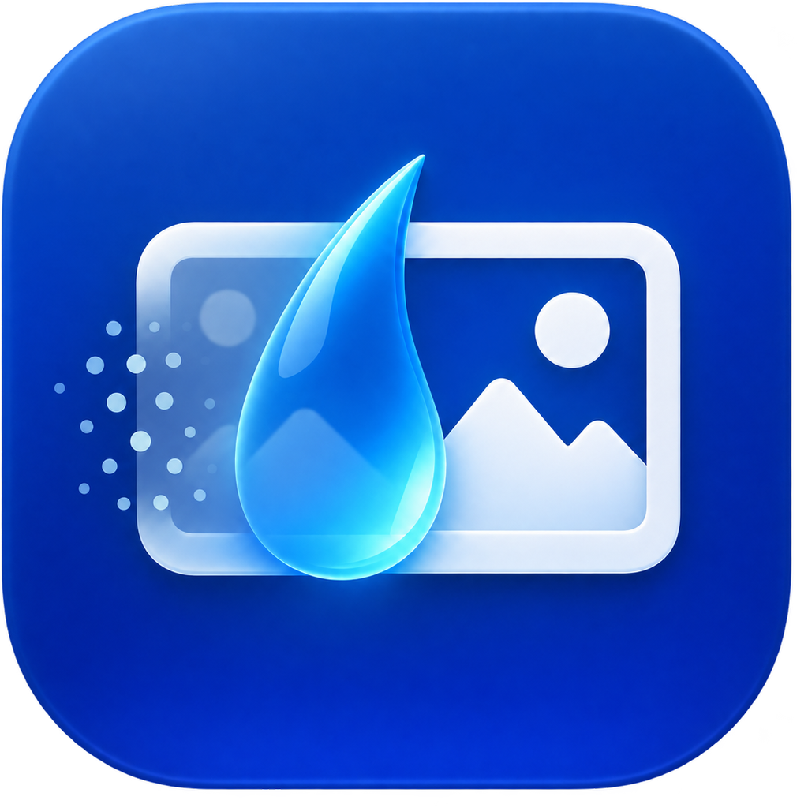

# Washer

Tiny native macOS drag-and-drop utility for inspecting and removing image metadata.

Drop an image, review the metadata and any code-like text Washer finds, then click **Wash metadata**. Washer writes a new `-washed` file beside the original. It uses ExifTool so the image is not decoded or recompressed; the original is never changed.

Supported: JPEG, PNG, HEIC, TIFF and WebP. ExifTool is required (`brew install exiftool`).

## Launch

Double-click `command.launcher`. On first run it compiles the tiny app, which may take a minute, then opens Washer. The launcher uses the matching Xcode toolchain when Xcode is installed. If macOS blocks the script, right-click it and choose **Open**.
